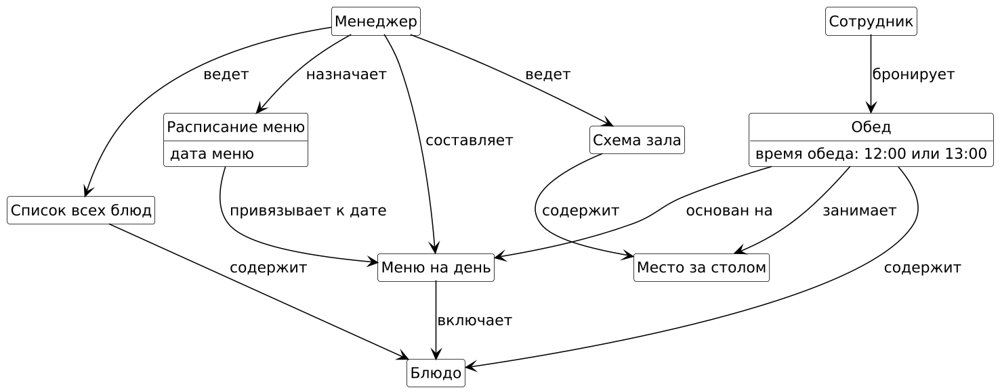

# 3.1. Доменная модель

Доменная модель ([рисунок 3.1](#risunok-3-1)) показывает основные понятия и связи между ними. Менеджер ведет список всех блюд, составляет из него меню на день и назначает меню на дату в расписании. Сотрудник бронирует обед: выбирает блюда из меню на сегодня, время обеда (12:00 или 13:00) и место за столом на схеме зала. Время обеда — свойство обеда, расписание задает только дату меню.

Рисунок 3.1 — Доменная модель
{: #risunok-3-1 .caption }
