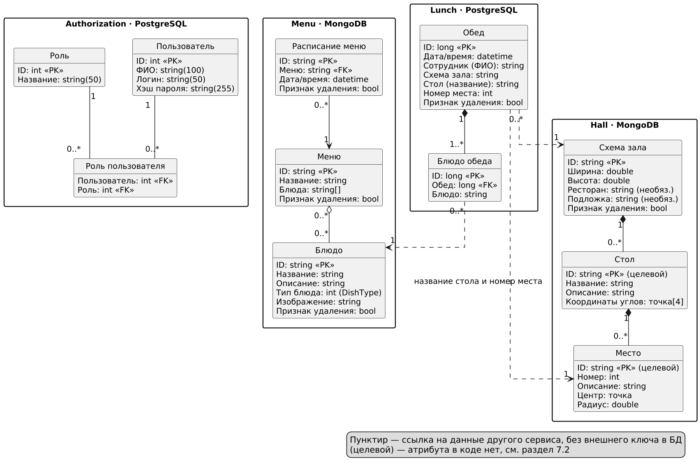

# 3.2. Логическая модель данных

Логическая модель данных ([рисунок 3.2](#risunok-3-2)) построена по сущностям из кода сервисов. У каждого сервиса своя база данных: Authorization и Lunch хранят данные в PostgreSQL, Menu и Hall — в MongoDB. Обед ссылается на блюда и схему зала по идентификаторам, на стол — по названию (поле TableName), на место — по номеру в пределах стола. Это данные других сервисов, внешних ключей между базами нет. У стола и места в коде нет ID, в модели они показаны как целевые атрибуты с пометкой «(целевой)», см. [раздел 7.2](../07-rezultat/7.2-naydeno-pri-revizii.md).

Рисунок 3.2 — Логическая модель данных по сервисам
{: #risunok-3-2 .caption }
