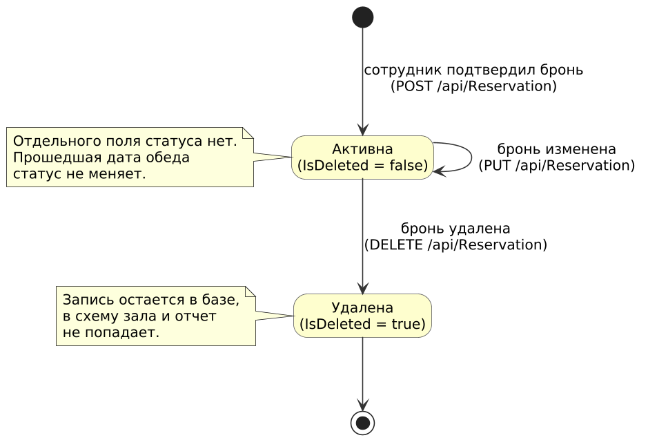
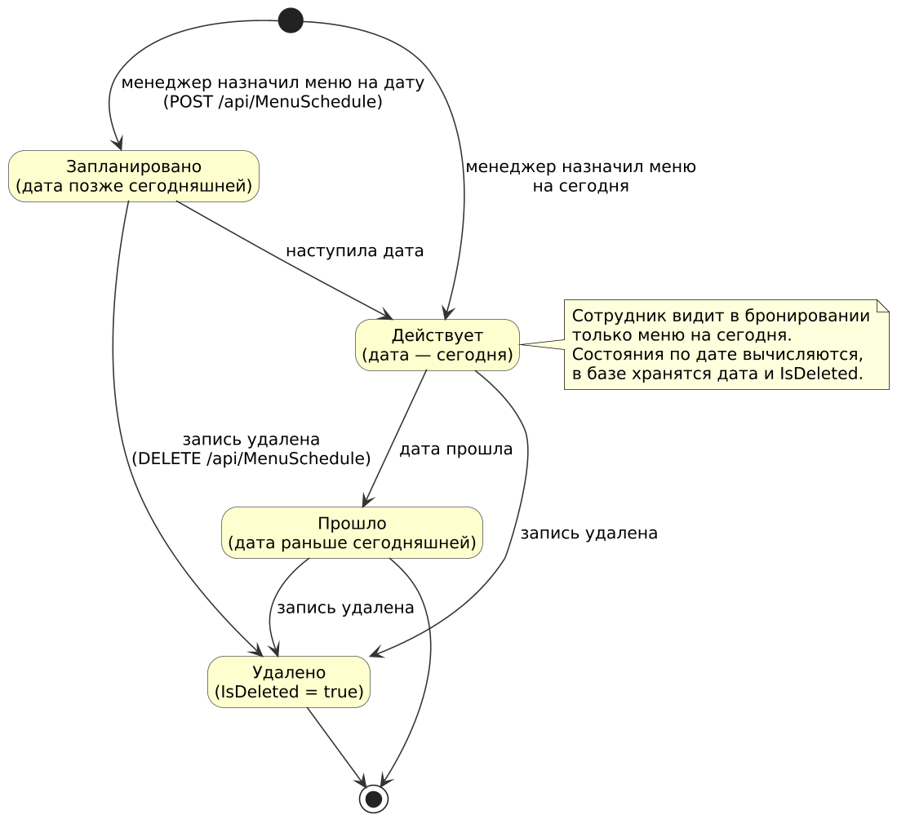

# 3.5. Перечисления и статусные модели

Перечисления и статусы приведены в [таблице 3.3](#tablitsa-3-3). Значения указаны так, как они хранятся в коде и передаются в API: перечисления передаются в JSON числами. Отдельных полей статуса в коде нет: состояние брони, блюда, меню и схемы зала задает признак удаления IsDeleted, состояние меню на дату вычисляется по дате.

Таблица 3.3 — Перечисления и статусы
{: #tablitsa-3-3 .caption }

| Перечисление | Значения в коде и API | Источник и поле API |
| --- | --- | --- |
| Тип блюда | 0 — Soup (суп), 1 — HotDish (горячее), 2 — Salad (салат), 3 — Drink (напиток) | DishType (Menu); поле dishType в /api/Dish |
| Роль | 1 — Admin (администратор), 2 — Manager (менеджер). Пользователь без ролей работает как сотрудник | RoleEnum (Authorization); roleIds в PUT /api/Users/&#123;userId&#125;/roles, roles в GET /api/Auth/userInfo |
| Время обеда | 12:00, 13:00. Перечисления в коде нет: время входит в поле date брони | поле date в /api/Reservation |
| Состояние брони | isDeleted = false — активна, true — удалена | IsDeleted брони (Lunch); поле isDeleted в /api/Reservation |
| Состояние меню на дату | Запланировано, действует, прошло, удалено | дата и IsDeleted расписания меню (Menu); состояния по дате вычисляются |
| Состояние блюда, меню, схемы зала | isDeleted = false — активно, true — удалено | IsDeleted (Menu, Hall); поле isDeleted |
| Состояние пользователя | Статуса нет: учетная запись удаляется из базы | Authorization |

Переходы брони приведены на [рисунке 3.3](#risunok-3-3) и в [таблице 3.4](#tablitsa-3-4), меню на дату — на [рисунке 3.4](#risunok-3-4) и в [таблице 3.5](#tablitsa-3-5).

Рисунок 3.3 — Статусная модель брони
{: #risunok-3-3 .caption }

Таблица 3.4 — Переходы брони
{: #tablitsa-3-4 .caption }

| Из | В | Событие | Как в коде |
| --- | --- | --- | --- |
| — | Активна | сотрудник подтвердил бронь | POST /api/Reservation, IsDeleted = false |
| Активна | Активна | бронь изменена | PUT /api/Reservation |
| Активна | Удалена | бронь удалена | DELETE /api/Reservation, IsDeleted = true, запись остается в базе |

Рисунок 3.4 — Статусная модель меню на дату
{: #risunok-3-4 .caption }

Таблица 3.5 — Переходы меню на дату
{: #tablitsa-3-5 .caption }

| Из | В | Событие | Как в коде |
| --- | --- | --- | --- |
| — | Запланировано | менеджер назначил меню на будущую дату | POST /api/MenuSchedule |
| — | Действует | менеджер назначил меню на сегодня | POST /api/MenuSchedule |
| Запланировано | Действует | наступила дата меню | вычисляется по дате |
| Действует | Прошло | дата меню прошла | вычисляется по дате |
| Запланировано, действует, прошло | Удалено | запись расписания удалена | DELETE /api/MenuSchedule, IsDeleted = true |

Блюдо, меню и схема зала переходят из состояния «Активно» в «Удалено» при удалении (DELETE), запись остается в базе. Удаленная бронь не попадает в схему зала и отчет. Через PUT признак IsDeleted брони можно изменить в обе стороны, сценария восстановления брони в документе нет. Прошедшая дата обеда состояние брони не меняет.

Статусов «меню с бронями» ([ОГР-03](../02-trebovaniya/2.2-ogranicheniya-i-pravila.md#ogr-03) «Меню с бронями не меняется») и «схема опубликована» в коде нет. Блокировка пользователя не предусмотрена: учетную запись удаляют.
