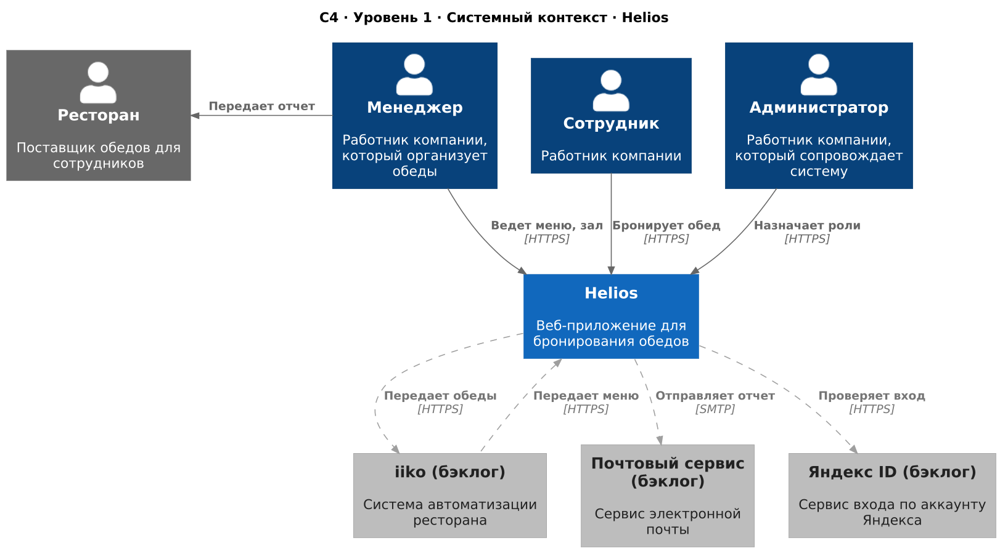
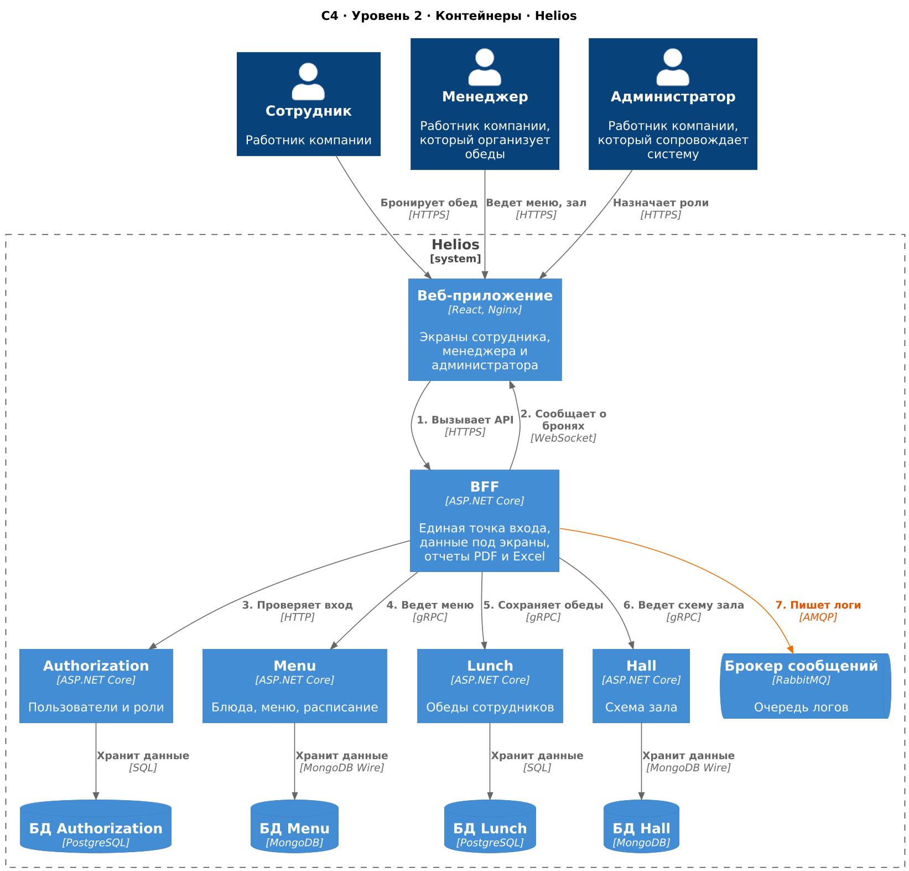
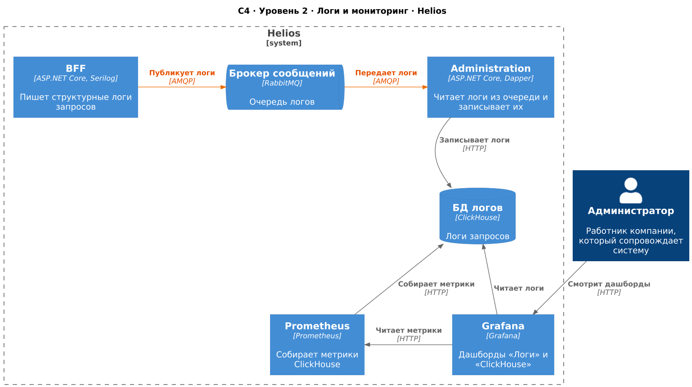

# 4.2. Диаграммы C4

Системный контекст приведен на [рисунке 4.1](#risunok-4-1): пользователи, ресторан и внешние системы. Внешние системы с пометкой «(бэклог)» в текущую версию не входят, связи с ними показаны пунктиром.

Рисунок 4.1 — Системный контекст, уровень 1
{: #risunok-4-1 .caption }

Контейнеры приведены на [рисунке 4.2](#risunok-4-2). У стрелок указаны номер, короткая подпись и протокол, номера совпадают с номерами потоков в [таблице 4.3](4.3-perechen-integraciy.md#tablitsa-4-3). Логи и мониторинг вынесены на [рисунок 4.3](#risunok-4-3).

Рисунок 4.2 — Контейнеры системы, уровень 2
{: #risunok-4-2 .caption }

Рисунок 4.3 — Логи и мониторинг, уровень 2
{: #risunok-4-3 .caption }
