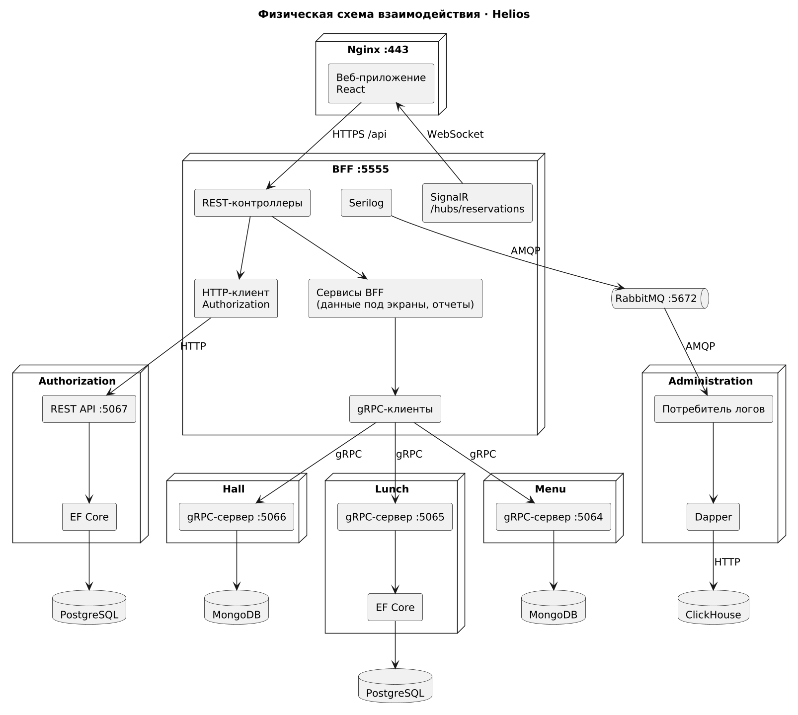
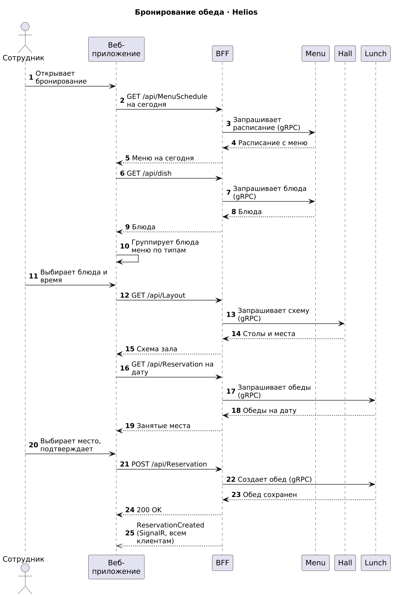
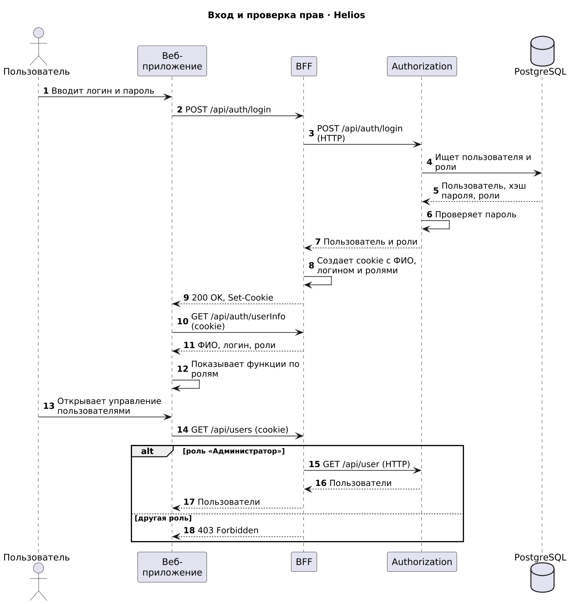

# 4.4. Схема и описание интеграции

Физическая схема ([рисунок 4.4](#risunok-4-4)) показывает реализованное взаимодействие с портами: веб-приложение работает за Nginx, BFF вызывает сервисы по gRPC и HTTP, логи идут по цепочке Serilog → RabbitMQ → Administration → ClickHouse.

Рисунок 4.4 — Физическая схема взаимодействия
{: #risunok-4-4 .caption }

Бронирование обеда показано на [рисунке 4.5](#risunok-4-5): данные меню, схемы зала и обедов веб-приложение получает через BFF, после сохранения брони BFF рассылает событие через SignalR. Вход и проверка прав показаны на [рисунке 4.6](#risunok-4-6): BFF проверяет логин и пароль в Authorization и хранит роли в cookie.

Рисунок 4.5 — Бронирование обеда
{: #risunok-4-5 .caption }

Рисунок 4.6 — Вход и проверка прав
{: #risunok-4-6 .caption }
