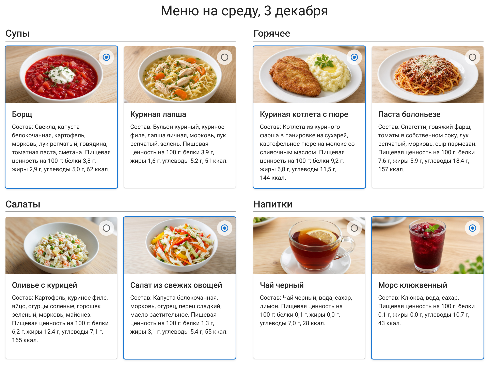

# 7.1. Что реализовано

Первый спринт доведен до работающего интерфейса: сотрудник видит меню на день по типам блюд и выбирает блюда ([рисунок 7.1](#risunok-7-1)). Основной вход — по логину и паролю; вход через Яндекс не доведен, в интерфейсе есть только кнопка.

Рисунок 7.1 — Экран выбора блюд из меню на день
{: #risunok-7-1 .caption }

Экран воспроизведен по компоненту MenuDisplay веб-приложения на примере меню бизнес-ланча. Карточка блюда показывает фото, название и описание. Состав и пищевая ценность на 100 г записаны в описании блюда, отдельных полей для них в сущности «Блюдо» нет. Фото блюд и напитков сгенерированы.

По физической схеме ([рисунок 4.4](../04-arhitektura/4.4-shema-i-opisanie-integracii.md#risunok-4-4)) реализованы веб-приложение на React, BFF и сервисы Menu, Lunch, Hall, Authorization и Administration. Логи BFF передаются в Administration через RabbitMQ и хранятся в ClickHouse. Сборка, тесты и деплой автоматизированы в GitHub Actions.

Реализованы частично: [US-01](../06-kriterii/6.1-menyu.md#us-01), [US-03](../06-kriterii/6.2-bronirovanie-obeda.md#us-03)–[US-05](../06-kriterii/6.2-bronirovanie-obeda.md#us-05), [US-13](../06-kriterii/6.4-polzovateli-i-roli.md#us-13), [US-14](../06-kriterii/6.4-polzovateli-i-roli.md#us-14), [US-16](../06-kriterii/6.5-monitoring.md#us-16) и [US-18](../06-kriterii/6.6-shema-zala.md#us-18). Основной сценарий работает, но часть проверок выполняет только интерфейс или отсутствует, подробности — в [разделе 7.2](7.2-naydeno-pri-revizii.md).

Не реализованы: загрузка меню и передача обедов в iiko, отправка отчета по email и по расписанию, удаление устаревших данных, метрики времени ответа и ошибок по сервисам, нагрузочное тестирование, кеш Redis в BFF. Распределение работ по спринтам — в [разделе 8](../08-sprinty.md).
