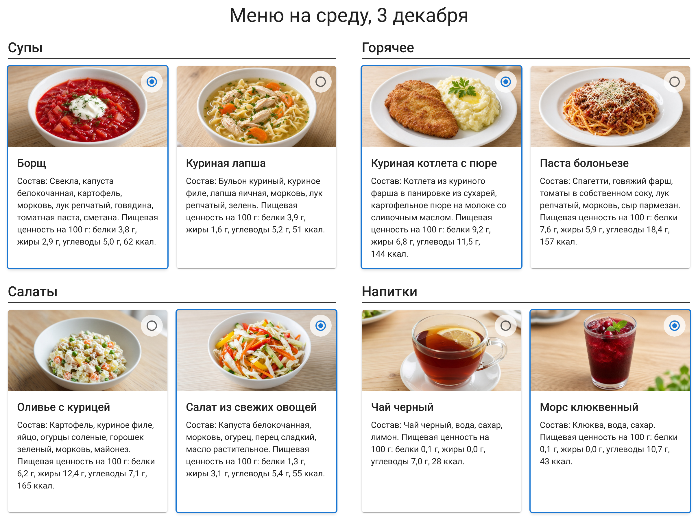

---
hide:
  - toc
  - footer
icon: material/home
---

# Таверна Helios

Портфолио системного аналитика: требования и архитектура сервиса бронирования обедов

Учебный командный проект, программа OTUS «C# ASP.NET Core разработчик»

Репозиторий: [https://github.com/CoffeePrograms/coursework-restaurant-helios](https://github.com/CoffeePrograms/coursework-restaurant-helios)

Системный аналитик и разработчик: Липова Эльвира Евгеньевна

Telegram-канал «Эльвира Липова · От требований к коду»: [t.me/lipova_ee](https://t.me/lipova_ee)

Telegram: [@CoffeePrograms](https://t.me/CoffeePrograms)

[Начать читать](01-biznes-trebovaniya/1.1-obekt-avtomatizacii.md){ .md-button .md-button--primary }
[Контракт POST /api/Reservation](05-api/5.2-kontrakt-post-reservation.md){ .md-button }

## Кратко

Helios — веб-сервис, в котором сотрудники компании бронируют обед в ресторане: выбирают блюда из меню на день, время и место за столом. Менеджер ведет меню и схему зала и передает ресторану отчет. Учебный командный проект выполнен с января по июнь 2025 года, документ я переработала в 2026 году.

Моя роль — системный аналитик и разработчик в команде из четырех человек. Опыт: 6 лет — разработчик C#, 1 год — системный аналитик. Опыт разработки помогает сверять требования с кодом: НФТ и статусы историй проверены по репозиторию, расхождения собраны в [разделе 7.2](07-rezultat/7.2-naydeno-pri-revizii.md).

Что я сделала как системный аналитик:

- требования бизнеса, метрики и бизнес-процессы «как сейчас» и «как будет» (разделы [1.3](01-biznes-trebovaniya/1.3-trebovaniya-biznesa.md)–[1.5](01-biznes-trebovaniya/1.5-biznes-processy.md));
- ограничения, НФТ и 19 пользовательских историй с критериями приемки на Gherkin (разделы [2](02-trebovaniya/2.1-roli-i-uchastniki-vzaimodeystviya.md) и [6](06-kriterii/index.md));
- доменную и логическую модели, связи и кратность, статусные модели ([раздел 3](03-informacionnaya-model/3.1-domennaya-model.md));
- обоснование архитектурного стиля, диаграммы C4 и перечень интеграций ([раздел 4](04-arhitektura/4.1-obosnovanie-arhitekturnogo-stilya.md));
- перечень API и контракт метода создания брони ([раздел 5](05-api/5.1-resursy-i-endpointy.md));
- ревизию кода: расхождения с требованиями и рекомендации ([раздел 7.2](07-rezultat/7.2-naydeno-pri-revizii.md)).

Результат: работающее веб-приложение (экран выбора блюд — [рисунок 7.1](07-rezultat/7.1-chto-realizovano.md#risunok-7-1)), автоматические сборка, тесты и развертывание в Kubernetes через GitHub Actions.

Стек: React, ASP.NET Core, gRPC, SignalR, RabbitMQ, PostgreSQL, MongoDB, ClickHouse, Prometheus, Grafana, Docker, Kubernetes.

Что посмотреть за 5 минут: бизнес-процессы ([раздел 1.5](01-biznes-trebovaniya/1.5-biznes-processy.md)), НФТ ([раздел 2.3](02-trebovaniya/2.3-nefunkcionalnye-trebovaniya.md)), диаграммы C4 ([раздел 4.2](04-arhitektura/4.2-diagrammy-c4.md)), бронирование обеда ([раздел 6.2](06-kriterii/6.2-bronirovanie-obeda.md)), ревизию кода ([раздел 7.2](07-rezultat/7.2-naydeno-pri-revizii.md)).

Контакты: Telegram-канал «Эльвира Липова · От требований к коду» — [t.me/lipova_ee](https://t.me/lipova_ee), личный Telegram — [@CoffeePrograms](https://t.me/CoffeePrograms), репозиторий — [github.com/CoffeePrograms/coursework-restaurant-helios](https://github.com/CoffeePrograms/coursework-restaurant-helios).

Экран выбора блюд из меню на день ([рисунок 7.1](07-rezultat/7.1-chto-realizovano.md#risunok-7-1))

  19 историй
  9 ограничений
  15 НФТ
  6 бизнес-процессов
  11 рисунков

- :material-book-alphabet:{ .lg .middle } __Глоссарий__

    ---

    Термины, которые используются в документе.

    [:octicons-arrow-right-24: Глоссарий](glossariy.md)

- :material-silverware-fork-knife:{ .lg .middle } __1. Бизнес-требования__

    ---

    Цели, метрики, бизнес-процессы и границы.

    [:octicons-arrow-right-24: Раздел 1](01-biznes-trebovaniya/1.1-obekt-avtomatizacii.md)

- :material-file-document-outline:{ .lg .middle } __2. Требования к приложению__

    ---

    Роли, ограничения, нефункциональные требования и истории.

    [:octicons-arrow-right-24: Раздел 2](02-trebovaniya/2.1-roli-i-uchastniki-vzaimodeystviya.md)

- :material-graph-outline:{ .lg .middle } __3. Информационная модель__

    ---

    Доменная и логическая модели, связи и статусные модели.

    [:octicons-arrow-right-24: Раздел 3](03-informacionnaya-model/3.1-domennaya-model.md)

- :material-sitemap:{ .lg .middle } __4. Архитектура__

    ---

    Архитектурный стиль, диаграммы C4 и интеграции.

    [:octicons-arrow-right-24: Раздел 4](04-arhitektura/4.1-obosnovanie-arhitekturnogo-stilya.md)

- :material-api:{ .lg .middle } __5. API__

    ---

    Ресурсы и контракт метода POST /api/Reservation.

    [:octicons-arrow-right-24: Раздел 5](05-api/5.1-resursy-i-endpointy.md)

- :material-format-list-checks:{ .lg .middle } __6. Критерии приемки__

    ---

    Критерии приемки историй на Gherkin.

    [:octicons-arrow-right-24: Раздел 6](06-kriterii/index.md)

- :material-clipboard-check-outline:{ .lg .middle } __7. Результат__

    ---

    Что реализовано и что найдено при ревизии.

    [:octicons-arrow-right-24: Раздел 7](07-rezultat/7.1-chto-realizovano.md)

- :material-calendar-month:{ .lg .middle } __8. Спринты__

    ---

    Спринты и состав работ.

    [:octicons-arrow-right-24: Раздел 8](08-sprinty.md)

- :material-file-code-outline:{ .lg .middle } __Приложение А__

    ---

    Исходники схем PlantUML и макет экрана меню.

    [:octicons-arrow-right-24: Приложение А](prilozhenie-a.md)

## Об авторе

Липова Эльвира Евгеньевна, системный аналитик и разработчик. 6 лет — разработчик C#, 1 год — системный аналитик.

[:fontawesome-brands-telegram: Эльвира Липова · От требований к коду](https://t.me/lipova_ee)

[:fontawesome-brands-telegram: @CoffeePrograms](https://t.me/CoffeePrograms)

[Репозиторий кода](https://github.com/CoffeePrograms/coursework-restaurant-helios)

Учебный командный проект выполнен с января по июнь 2025 года, документ я переработала в 2026 году.

